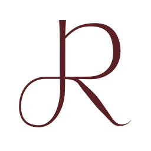
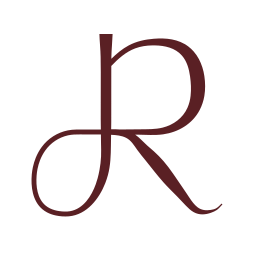
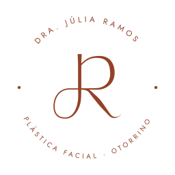
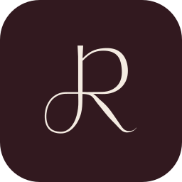
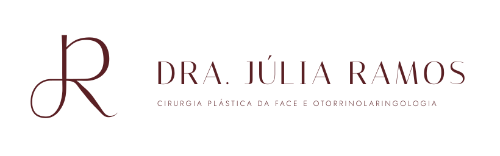
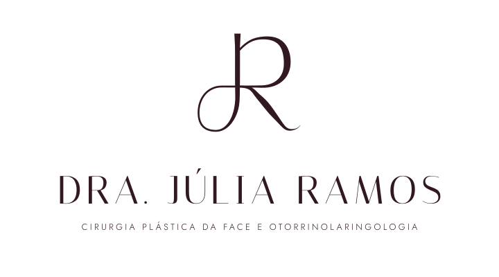

# Identidade Visual & Logotipo SVG — Dra. Júlia Ramos

**Especialidade:** Cirurgia Plástica da Face e Otorrinolaringologia  
**Conceito Aprovado:** **Versão C — Escultura Natural** *(monograma caligráfico orgânico `JR` sem moldura + tipografia arquitetônica de alta-costura)*

Todos os arquivos SVG deste repositório são **100% vetoriais puros**:
- **Zero `<text>` vivo** (toda a tipografia foi convertida em curvas `<path>` via Inkscape — abre perfeitamente em Illustrator, Figma, CorelDRAW, Canva, gráficas e navegadores sem precisar instalar fontes).
- **Símbolo unificado em 1 único `<path>`** via união booleana (*path union*), pronto para recorte em vinil, hot-stamping, gravação a laser e bordado em jaleco sem sobreposições ou emendas.
- **Validados** com `xmllint --noout` (0 erros XML) e auditados com `svg_audit.py`.

---

## Prévia dos Arquivos Mestres

| Símbolo Mestre (Cherry Velvet) | Corte Ótico 16–32 px | Selo Circular (Terracotta) | App Icon (Bordeaux Noir) |
| :---: | :---: | :---: | :---: |
|  |  |  |  |

**Assinatura Horizontal (Cherry Velvet):**  


**Assinatura Vertical (Bordeaux Noir):**  


---

## Estrutura de Pastas

```text
svg/
├── simbolo/        # Símbolo JR isolado (7 cores + currentColor) + corte ótico 16–32 px
├── horizontal/     # Assinatura horizontal completa (7 variações de cor)
├── vertical/       # Assinatura vertical / stacked completa (7 variações de cor)
├── wordmark/       # Wordmark completo + versão compacta só com nome (sem subtítulo)
├── selo/           # Selo circular / submarca (7 variações de cor)
├── icones/         # favicon.svg, app-icons arredondados e avatares circulares
└── padronagens/    # Padronagens (patterns) repetíveis sem emenda em 6 cores
tokens/
├── brand-tokens.css   # Variáveis CSS da paleta e tipografia
└── brand-tokens.json  # Tokens estruturados (cores, OKLCH, regras de uso)
```

---

## Paleta Cromática Unificada

| Cor | HEX | OKLCH | Papel na Marca | Contraste sobre Warm Ivory |
| :--- | :---: | :---: | :--- | :---: |
| **Warm Ivory** | `#F4EBE1` | `0.944 / 0.017 / 70.5°` | Fundo principal claro, papelaria | — |
| **Alpine Oat** | `#DFCFC0` | `0.864 / 0.027 / 65.6°` | Superfície secundária, cartões | `10.68:1` c/ Bordeaux (**AAA**) |
| **Warm Taupe** | `#A38770` | `0.643 / 0.048 / 61.2°` | Neutro quente, filetes e detalhes | `4.83:1` c/ Bordeaux (**AA**) |
| **Terracotta** | `#944227` | `0.482 / 0.118 / 38.5°` | Acento terroso, padronagens | `5.81:1` (**AA**) |
| **Olive Green** | `#5B5033` | `0.434 / 0.046 / 89.6°` | Acento botânico natural | `6.75:1` (**AA+**) |
| **Cherry Velvet** | `#5A2024` | `0.332 / 0.085 / 18.9°` | Assinatura rubi/vinho principal | `10.69:1` (**AAA**) |
| **Bordeaux Noir** | `#32191F` | `0.250 / 0.041 / 5.0°` | Âncora escura, fundos de luxo | `13.76:1` (**AAA**) |

> **Regra de acessibilidade (CVD):** Nunca aplique `Terracotta` diretamente sobre `Olive Green` sem separação neutra (`ΔE2000 = 3.8` sob protanopia). Combine sempre com `Warm Ivory`, `Alpine Oat` ou `Bordeaux Noir`.

---

## Tipografia & Diretrizes Rápidas

- **Display (Títulos / Wordmark):** `Italiana` (Regular · SIL OFL — uso comercial livre, cobertura completa de acentos PT-BR).
- **Apoio (Subtítulo / Corpo):** `Jost` (Light / Regular · SIL OFL — uso comercial livre).
- **Área de respiro (Clear Space):** Manter margem livre mínima equivalente a `25%` da altura do símbolo ao redor de toda assinatura.
- **Tamanhos mínimos:**
  - **Símbolo padrão:** ≥ `32 px` (digital) ou `12 mm` (impresso).
  - **Símbolo corte ótico pequeno (`*-pequeno-*.svg`):** usar entre `16 px` e `32 px`, favicons e bordados delicados.
  - **Assinatura com subtítulo:** ≥ `180 px` de largura (digital) ou `45 mm` (impresso). Abaixo disso, usar `dra-julia-ramos-nome-*.svg` (sem subtítulo) ou apenas o símbolo.
- **Registro de marca:** Recomenda-se pesquisa de anterioridade no INPI antes do registro definitivo.
