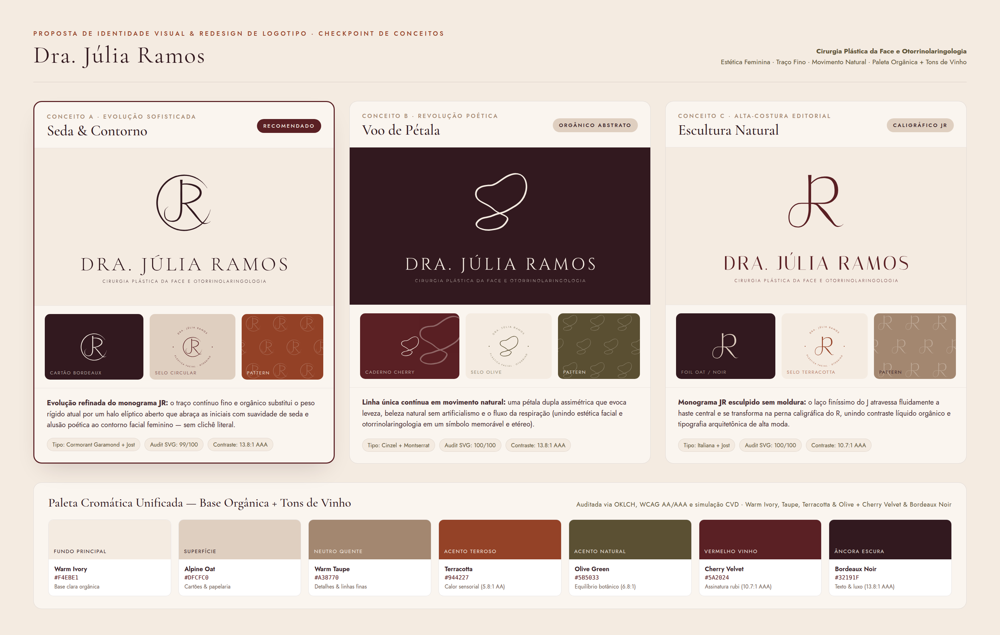
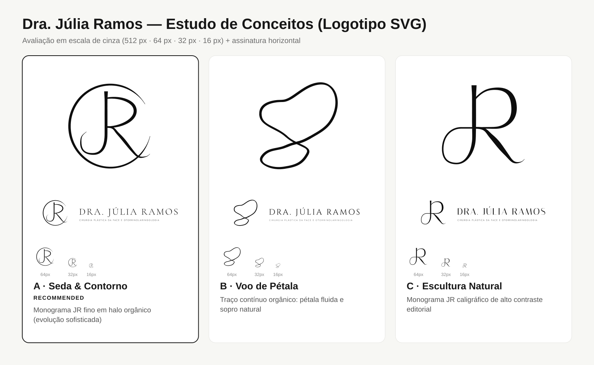
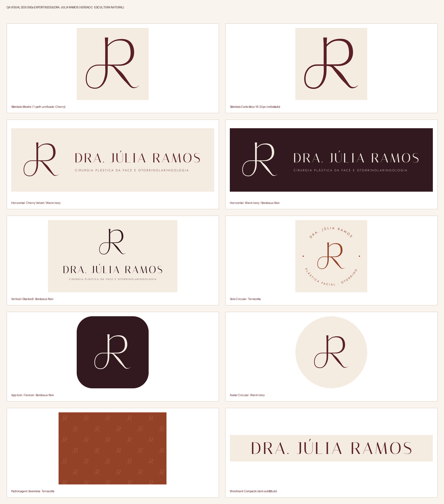

# Apresentação de Identidade Visual — Dra. Júlia Ramos

**Especialidade:** Cirurgia Plástica da Face e Otorrinolaringologia  
**Versão Aprovada:** **Conceito C — Escultura Natural**

## Arquivos para Download nesta Pasta
- **`dra-julia-ramos-apresentacao.pdf`** — Apresentação executiva em **PDF (6 slides 16:9)** pronta para enviar por WhatsApp, e-mail ou apresentar em tela cheia.
- **`studio-interativo.html`** — **Estúdio Interativo 100% Offline** (basta abrir com duplo clique no Chrome, Edge ou Safari — não precisa de internet) para alternar ao vivo entre os 3 conceitos, testar as 7 cores da paleta unificada, medir contraste WCAG e ver os mockups.
- **`dra-julia-ramos-prancha-identidade.png`** — Prancha comparativa colorida das 3 direções em alta resolução.
- **`dra-julia-ramos-conceitos-escala.png`** — Folha técnica em escala de cinza com teste real de redução (512 / 64 / 32 / 16 px).
- **`dra-julia-ramos-versao-c-exportados.png`** — Prancha de conferência visual dos 57 SVGs finais da Versão C.

---

## Prancha Comparativa — 3 Direções de Identidade Visual

## Avaliação Técnica em Escala de Cinza (512 / 64 / 32 / 16 px)

## Conferência Visual dos SVGs Exportados (Versão C — Escultura Natural)

